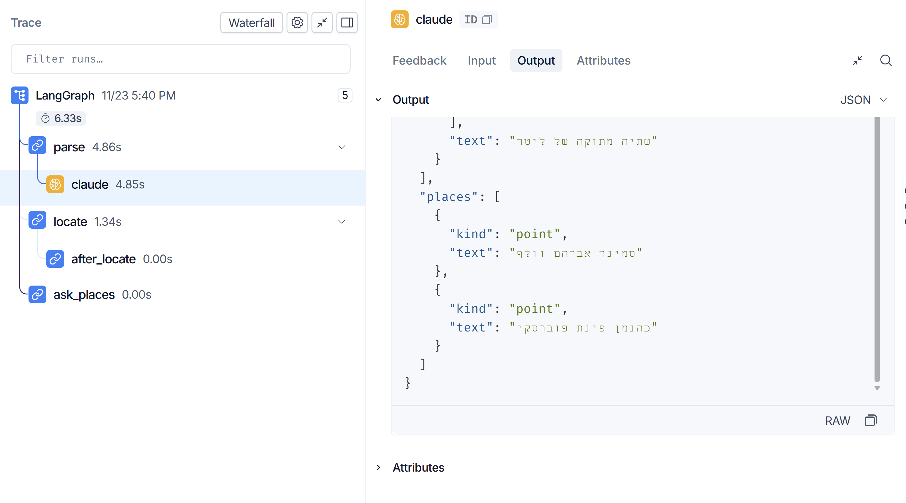
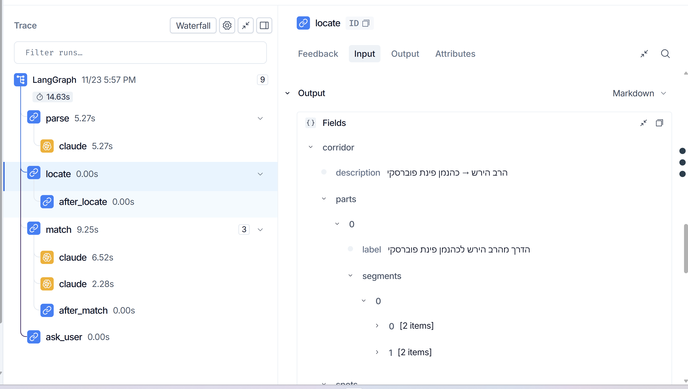
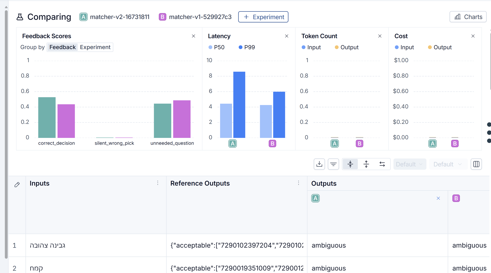

# 🛒 סוכן סל קניות זול, לפי איפה שאתה נמצא

> 📸 **לבודק/ת: צילומי ה-trace והתובנה (שיעורי הבית) נמצאים בסעיף [צילומי trace ותובנה](#צילומי-trace-ותובנה).**

**תוכן העניינים**
- **הסוכן:** [מה אפשר לכתוב כמיקום](#מה-אפשר-לכתוב-כמיקום) · [איך זה עובד](#איך-זה-עובד) · [איך נבחר הסל](#איך-נבחר-הסל) · [מבנה הקבצים](#מבנה-הקבצים)
- **הפעלה:** [התקנה](#התקנה-windows) · [הרצה](#הרצה) · [עדכון מחירים אוטומטי (בעתיד)](#בעתיד-עדכון-מחירים-אוטומטי-בשרת) · [עלויות ופרטיות](#עלויות-ופרטיות)
- **התרגיל:** [הערכה ב-LangSmith](#הערכה-ב-langsmith-לפני-ואחרי) · [עמידה בדרישות](#עמידה-בדרישות-התרגיל) · **[צילומי trace ותובנה](#צילומי-trace-ותובנה)** ([פינת רחובות](#התובנה-הסוכן-לא-מבין-פינת-רחובות-מה-trace-התברר-שהמודל-הבין-והמפה-היא-שנכשלה) · [v1 מול v2](#השוואת-v1-מול-v2-ב-langsmith) · [תובנה שנייה ו-v3](#תובנה-שנייה-מה-trace-ותיקון-שלה-v3))
- **המשך:** [צעד הבא: מהירות](#צעד-הבא-לשיפור-מהירות) · [פרטיות ואבטחה](#לפני-משתמשים-אמיתיים-פרטיות-ואבטחה) · [מגבלות](#מגבלות-ושלבים-הבאים) · [תיקונים מעניינים בדרך](#תיקונים-מעניינים-בדרך)

כותבים בהודעה אחת איפה גרים, או איפה נמצאים היום, ומה צריך לקנות:

> "אני גר ברבי עקיבא 100. צריך חלב, גבינה לבנה, 2 לחם וביצים"

> "הולך בכהנמן מאזור מכבי עד ז'בוטינסקי. צריך חלב, קוטג' וביצים"

הסוכן מוצא את המוצרים במחירים האמיתיים של רשתות השיווק, **רק בסניפים שעל הדרך שלך**, ושואל כשמשהו לא ברור.

### מה אפשר לכתוב כמיקום
| המשתמש כותב | המערכת מבינה | איפה מחפשים |
|---|---|---|
| "ר' עקיבא 20", "ליד קניון בני ברק" | **נקודה** | עד 700 מ' סביבה |
| "הולך בכהנמן מאזור מכבי עד ז'בוטינסקי" | **קטע רחוב**: מ- ועד- | עד 300 מ' מכל נקודה לאורך הקטע, וסביב הקצוות |
| "בכהנמן מ-30 עד 90" | קטע לפי מספרי בית | כנ"ל |
| "עובר בכהנמן ואז פונה לרבי עקיבא" | **פנייה**: הצומת מחושב | לאורך כהנמן עד הצומת, ועד 500 מ' מהצומת ברבי עקיבא, לשני הכיוונים |

נקודות התחלה וסיום של קטע יכולות להיות **מספר בית**, **רחוב חוצה** (הקוד מוצא את הצומת), או **מקום מוכר** (מחפשים אותו במפה על אותו רחוב). הוא אומר לך איפה הכי משתלם ובאיזה מרחק, ומציג גם חנויות שכונתיות באזור שאין עליהן נתוני מחירים, עם רושם זהיר ממה שנכתב עליהן ברשת.

**מקורות הנתונים, כולם חינמיים:**
| מה | מאיפה |
|---|---|
| מחירים | קבצי המחירים שרשתות השיווק מפרסמות לפי חוק |
| מיקום כתובות וסניפים | OpenStreetMap (Nominatim) |
| חנויות נוספות באזור | OpenStreetMap (Overpass) |
| רושם על מחירים בחנויות שכונתיות | חיפוש ברשת דרך Claude |

---

## איך זה עובד

```
 parse ──► locate ──► match ──► price ──┬──────────────────────► nearby ──► answer
             ▲  │       ▲  │            ├─► choose_store ⏸ ──────►  ▲
             │  ▼       │  ▼            └─► confirm_split ⏸ ─────►  ┘
         ask_places ⏸  ask_user ⏸
```

| שלב | מה קורה | מי עושה |
|---|---|---|
| **parse** | מפריד בין **המקומות** לבין **רשימת הקניות**. מזהה נקודה, קטע רחוב או פנייה, ופותח קיצורים. לכל פריט קובע גם אילו חנויות מתמחות מוכרות אותו (מאפייה, ירקן, קצב...) | Claude |
| **locate** | בונה את **"הדרך" על המפה**: נקודות, קווי רחובות, צמתים וחיתוך הקטע | קוד + OpenStreetMap |
| **ask_places** ⏸ | **עצירה:** "לא מצאתי את 'מכבי' ברחוב כהנמן. איזה מספר בית?" / "כהנמן ורבי עקיבא לא נפגשים. דרך איזה רחוב?" / ברחוב עם שגיאת כתיב: "התכוונת ל'הרב רבינוב'?" (ההצעה נלקחת מרשימת הרחובות האמיתית בעיר) | המשתמש |
| **match** | לכל פריט: חיפוש מוצרים במסד הנתונים, ואז החלטה: ברור / עמום / לא נמצא | חיפוש: קוד. החלטה: Claude |
| **ask_user** ⏸ | **עצירה:** כל הפריטים הלא ברורים יחד. בוחרים, מדלגים או מנסחים מחדש | המשתמש |
| **price** | רק סניפים על הדרך. מחיר הסל בכל סניף, עם **חלופות** למוצר שחסר בסניף, השוואה **לאותה כמות**, הזול, הקרוב, וחלוקה בין שתי חנויות (פירוט בסעיף "איך נבחר הסל") | קוד בלבד |
| **choose_store** ⏸ | **עצירה:** "הזול חוסך 9 ₪ אבל רחוק יותר. מה מעדיף?" | המשתמש |
| **confirm_split** ⏸ | **עצירה:** "בשתי חנויות תחסוך X ₪. שווה עצירה נוספת?" | המשתמש |
| **nearby** | חנויות מזון באזור שאינן מהרשתות, ולקרובות שבהן חיפוש ברשת על רמת המחירים | מפה: קוד. חיפוש וסיכום: Claude |
| **answer** | הסיכום הסופי, כולל אזהרות על הדרך (מקום שלא נמצא, רחובות שלא נפגשים) ומוצרים שחסרים בסניף המומלץ | קוד |

**שתי לולאות:** כתובת שלא נמצאה חוזרת ל-locate, ופריט שנוסח מחדש חוזר ל-match.

**עקרונות בעיצוב:**
1. **המודל מבין, הקוד מחשב.** מרחקים, מחירים וסלים מחושבים בקוד, בדיוק מלא.
2. **אין המצאות:** כל מוצר שהמודל בוחר חייב להיות ברשימת המועמדים, וכל מקור שהוא מצטט על חנות חייב להופיע בתוצאות החיפוש האמיתיות. אם לא, הקוד מוחק אותו ונכתב "לא נמצא מידע".
3. **רושם, לא קביעה:** על חנויות בלי נתונים נכתב "מהתרשמות ממה שנכתב ברשת, נראה ש... כדאי לבדוק במקום", עם קישור למקור.
4. **שואלים רק כשצריך, ופעם אחת.** שאלות מרוכזות, ובחירות נשמרות לפעם הבאה.
5. **סל מלא קודם.** המשתמש רוצה לקנות את כל הרשימה, ולכן סניף שיש בו הכול מנצח סניף זול יותר שחסר בו משהו.

### איך נבחר הסל
1. **מוצר וחלופות.** לכל פריט המודל בוחר מוצר, ומסמן גם **חלופות** שטובות באותה מידה: אותו מוצר במותג, גודל או אריזה אחרים. גם כשהמשתמש בוחר בעצמו מבין האפשרויות, הבחירה מגיעה עם חלופות (ביצים L 12 של יצרן אחר, לא ביצים M).
2. **מה קונים בכל סניף.** סניף שמוכר את המוצר שנבחר: אותו מוצר. סניף שלא: החלופה **בגודל הכי קרוב**, עד פי 2.5 (12 ביצים → 18, אבל לא 100 גרם במקום 1 ק"ג). הגודל נלקח מהמשקל או הנפח, ובמוצרים ביחידות מהשם ("ביצים 18יח").
3. **"הכי זול".** כשהמשתמש כתב "הכי זול", בכל סניף נקנה המוצר הזול ביותר **לקילו או לליטר**.
4. **השוואה לאותה כמות.** הסניפים מושווים לפי מחיר הסל **לאותה כמות**: הכמות שהמשתמש כתב, ואם לא כתב, גודל האריזה הרגילה שהמודל בחר. מוצר בלי גודל ידוע מושווה לפי המחיר בקופה. המחיר שמוצג הוא המחיר בקופה, ולצידו "לאותה כמות" כשהם שונים.
5. **בחירת הסניף.** קודם הסניף שחסרים בו הכי מעט מוצרים, ואחר כך הזול. אם הקרוב יקר בהרבה מהזול, או ששתי חנויות יחד משלימות את החסר או חוסכות מספיק, הסוכן שואל.
6. **מוצר שאין באף סניף על הדרך.** נאמר איפה הכי קרוב לקנות אותו, ובכמה מטרים מהדרך.

---

## מבנה הקבצים

```
client/index.html   ← הלקוח: הדף בדפדפן (מפה, שאלות, התוצאה)
server/             ← השרת: הסוכן, הנתונים, ההערכה, וכל הקבצים בטבלה למטה
images/             ← צילומי ה-trace וההשוואה שב-README
```

| קובץ (בתוך `server/`) | תפקיד |
|---|---|
| `config.py` | כל ההגדרות: עיר, רשתות, מודל, מרחק מקסימלי, ספים |
| `server.py` | **שרת הממשק בדפדפן:** מגיש את `client/index.html` ומריץ את אותו גרף, עם מפה של הדרך, הסניפים והחנויות הנוספות |
| `app.py` | **נקודת הכניסה בטרמינל.** מריץ את הסוכן ומציג את השאלות |
| `agent/graph.py` | **הגרף של LangGraph:** הצמתים, הענפים, הלולאות וה-interrupt |
| `agent/matcher.py` | פירוק ההודעה, ומטקסט חופשי למוצר: חיפוש, החלטה ובדיקת עיגון |
| `agent/route.py` | **"הדרך" על המפה:** חיתוך קטע רחוב, מציאת צמתים, מרחק של חנות מהדרך, ותיקונים מהמשתמש. גאומטריה בלבד, בלי מודל |
| `agent/nearby.py` | חנויות נוספות על הדרך ורושם המחירים שלהן מהרשת, עם בדיקת מקורות |
| `agent/basket.py` | חישוב הסל: חלופות בכל סניף, גודל אריזה, השוואה לאותה כמות וחלוקה בין חנויות. קוד טהור, בלי מודל |
| `agent/prompts.py` | כל הפרומפטים. לפירוק ולהתאמה יש גרסאות: `v1` (לפני), `v2` (שיפור ראשון) ו-`v3` (התיקון מה-trace, בשימוש) |
| `agent/llm.py` | המקום היחיד שפונה ל-Claude: פלט מובנה (`ask`) וחיפוש ברשת (`search`) |
| `data/prices.py` | הורדת קבצי המחירים ובניית מסד הנתונים |
| `data/geo.py` | OpenStreetMap: כתובת לנקודה, קווי רחובות, הצעת רחוב דומה לשם עם שגיאת כתיב, וחנויות קרובות. עם שמירה למניעת פניות חוזרות |
| `data/manual_shops.py` | חנויות שחסרות במפה ואין להן קבצי מחירים, שנוספו ידנית (למשל נתיב החסד) |
| `data/inspect_promos.py` | כלי עזר: בדיקת קבצי המבצעים של הרשתות, לקראת תמיכה במבצעים |
| `data/db.py` | מסד הנתונים (SQLite): סניפים, מוצרים, מחירים, העדפות, מיקומים ורושם חנויות |
| `data/demo.py` | נתוני דמו (מחירים מומצאים) לניסוי לפני שההורדה עובדת |
| `eval/` | דאטהסט (`dataset.json`), תיוג וניסויים ב-LangSmith |

---

## התקנה (Windows)

**1. Python 3.13.** ספריית הורדת המחירים לא תומכת עדיין ב-3.14. מתקינים את 3.13 מ-python.org, לצד 3.14.

**2. סביבה וספריות.** בטרמינל, בתיקייה הראשית של הפרויקט:
```bash
py -3.13 -m venv .venv
```
```bash
.venv\Scripts\python.exe -m pip install -r server\requirements.txt
```

**3. מפתחות.** בתיקייה `server`, מעתיקים את `.env.example` לקובץ חדש בשם `.env` וממלאים:
- `ANTHROPIC_API_KEY` מ-console.anthropic.com
- `LANGSMITH_API_KEY` מ-smith.langchain.com

⚠️ את הקובץ `.env` לא משתפים ולא מעלים לשום מקום.

> **כל הפקודות מכאן מריצים מתוך התיקייה `server`** (`cd server`). כדי לקצר, `python` פירושו `..\.venv\Scripts\python.exe`.

---

## הרצה

**ניסוי מהיר עם נתוני דמו** (מחירים מומצאים, שני סניפים בבני ברק):
```bash
python -m data.demo
```
```bash
python app.py
```

**ממשק בדפדפן** (במקום הטרמינל):
```bash
python server.py
```
ואז נכנסים ל-http://127.0.0.1:8765. אחרי שינוי בקוד מפעילים את השרת מחדש (`Ctrl+C` ושוב), ומרעננים את הדף עם `Ctrl+F5`.

**נתונים אמיתיים.** מריצים מהמחשב בבית, כי חלק מאתרי הרשתות חסומים מחוץ לישראל. שלושה שלבים, פעם ביום או פעם בשבוע:
```bash
python -m data.prices download
```
```bash
python -m data.prices build
```
```bash
python -m data.geo stores
```
השלב השלישי מאתר את מיקום הסניפים במפה, בקצב של שנייה לסניף, כנדרש בכללי השימוש של OpenStreetMap. המיקומים נשמרים, ובפעם הבאה זה מיידי. סניף שהמפה לא מצאה (✗) לא ייכלל בחיפוש לפי מרחק.

---

## בעתיד: עדכון מחירים אוטומטי בשרת

עדיין לא מומש. אם הפרויקט יעלה לשרת, את עדכון המחירים מריצים כ**משימה מתוזמנת** (למשל כל לילה ב-03:00), ולא ידנית.

**מה צריך:**
1. **סקריפט עדכון אחד** שמריץ את שלושת השלבים לפי הסדר: `download`, אחר כך `build`, אחר כך `geo stores`.
2. **בנייה לקובץ נפרד והחלפה בסוף.** `build` מוחק את המחירים ובונה אותם מחדש, כך שמשתמש שמחפש באמצע יקבל סל ריק. לכן בונים את `shopping_new.db` בצד, ובסוף מחליפים אותו ב-`shopping.db` בפעולה אחת (`os.replace`). אם שלב כלשהו נכשל, לא מחליפים, ומשתמשים ממשיכים לקבל את המחירים של אתמול.
3. **תזמון**, לפי סוג השרת:

| שרת | תזמון |
|---|---|
| VM לינוקס | `cron`, למשל `0 3 * * * cd /app/server && ../.venv/bin/python -m data.update` |
| Render / Railway / Fly.io | Cron Job מובנה |
| Google Cloud / AWS / Azure | Cloud Scheduler / EventBridge |

**שימו לב:**
- **אתרי רשתות חסומים מחוץ לישראל.** השרת צריך להיות באזור ישראלי (למשל `me-west1` ב-Google Cloud או `il-central-1` ב-AWS). חלופה: להוריד ולבנות במחשב בבית ולהעלות לשרת רק את `shopping.db`.
- **דיסק קבוע.** בחלק מהפלטפורמות הדיסק נמחק בכל הפעלה מחדש. צריך persistent volume, אחרת `shopping.db` נעלם.
- **לא למחוק טבלאות של המשתמשים.** בקובץ החדש צריך להעתיק מהקובץ הישן את הבחירות השמורות, את מטמון המפה ואת המידע על חנויות נוספות.
- **הערכה (eval):** לא לעדכן מחירים בין ניסוי לניסוי, אחרת ההשוואה בין הגרסאות לא הוגנת.

---

## עלויות ופרטיות
- **מפות ונתוני מחירים:** חינם.
- **Claude:** לפי שימוש. **חיפוש ברשת** עולה סנט לחיפוש, ועוד הטקסט שנקרא. נבדקות עד 3 חנויות בכל ריצה, עד 2 חיפושים לחנות, **והתוצאה נשמרת לחודש**, כך שחנות לא נבדקת שוב.
- **הכתובות שלך** נשלחות ל-Claude רק בשלב הפירוק, ול-OpenStreetMap לצורך איתור. החיפוש ברשת כולל רק את שם החנות והעיר, **לא את הכתובת שלך**.

---

## הערכה ב-LangSmith: לפני ואחרי

**1. תיוג.** לכל פריט מסמנים אילו מוצרים נכונים, או שהפריט עמום וצריך לשאול:
```bash
python -m eval.label
```
**2. העלאה:**
```bash
python -m eval.label upload
```
**3. ניסוי לפני ואחרי:**
```bash
python -m eval.run_eval v1
```
```bash
python -m eval.run_eval v2
```
```bash
python -m eval.run_eval v3
```
**4. השוואה:** ב-LangSmith נכנסים ל-Datasets, ל-`shopping-matcher`, מסמנים את הניסויים ולוחצים Compare.

| מדד | מה בודק | כיוון רצוי |
|---|---|---|
| `correct_decision` | שאל כשצריך, או בחר מוצר נכון | ⬆ |
| `silent_wrong_pick` | **בחר לבד מוצר לא נכון.** הטעות המסוכנת | ⬇ |
| `unneeded_question` | שאל כשהתשובה הייתה ברורה. הטעות המעצבנת | ⬇ |

**מה השתנה בין v1 ל-v2** (`agent/prompts.py`):
- **חיפוש:** v1 מחפש רק את הטקסט כפי שנכתב. v2 מייצר כמה ניסוחים (גבינה / גבינת, בלי אחוזים ומשקל).
- **החלטה:** v1 תמיד בוחר מוצר. ל-v2 יש כללים מפורשים מתי לשאול, ואיסור לבחור מוצר מסוג אחר.

**מה השתנה בין v2 ל-v3** (רק בפרומפט ההחלטה; v3 היא הגרסה שהסוכן משתמש בה):
- הבדל ב**גודל אריזה, משקל, מספר יחידות, מותג או סוג אריזה** אינו סיבה לשאול. בוחרים את הנפוץ, ובשוויון את הזול.
- שואלים רק על **תכונה של המוצר עצמו**: אחוז שומן, טעם, סוג או גודל ביצים.
- הדוגמאות בפרומפט (קטשופ, מים מינרליים, גבינת שמנת, זיתים) **לא נלקחו מהדאטהסט**, כדי שההערכה תבדוק אם המודל למד את הכלל, ולא אם הוא זוכר את הדוגמאות.

**אחרי המדידה** נוספו ל-v3 שדות לבחירת הסל: חלופות לכל מוצר ולכל אפשרות, וסימון "הכי זול". כללי ההחלטה (מתי לבחור ומתי לשאול) לא השתנו, אבל ה-eval לא הורץ שוב אחרי התוספת.

---

## עמידה בדרישות התרגיל

| דרישה | איפה |
|---|---|
| ספריית LangGraph | `agent/graph.py` |
| לולאה וענף מותנה | **שתי לולאות:** `ask_places ← locate`, `ask_user ← match`. **ענפים:** `after_locate`, `after_match`, `after_ask`, `after_price` |
| interrupt / human-in-the-loop | **ארבעה:** מקום שלא נמצא או רחובות שלא נפגשים, מוצר לא ברור, זול מול קרוב, ופיצול לשתי חנויות |
| דאטהסט והערכה, לפני ואחרי | `eval/`, עם גרסאות `v1`, `v2` ו-`v3` |
| README עם צילומי trace ותובנה | הסעיף הבא |

---

## צילומי trace ותובנה

### התובנה: "הסוכן לא מבין פינת רחובות". מה-trace התברר שהמודל הבין, והמפה היא שנכשלה

**הבעיה:** הבקשה *"הולך מסמינר אברהם וולף לכהנמן פינת פוברסקי"* נעצרה בשאלה *"לא מצאתי במפה את 'כהנמן פינת פוברסקי'"*. מבחוץ זה נראה כאילו המודל לא הבין את הכתובת, והפתרון המתבקש היה לשנות את הפרומפט.

**מה ה-trace הראה:** כל שלב בגרף מופיע ב-trace בנפרד, עם הקלט והפלט שלו, ולכן אפשר לראות בדיוק איפה זה נשבר.

**1. שלב `parse`, הצומת `claude`:** המודל פירק את הכתובת **נכון**, ל-`point "כהנמן פינת פוברסקי"`.



**2. שלב `locate`:** הכתובת שהגיעה לשלב הזה תקינה, אבל החיפוש במפה החזיר שגיאה. OpenStreetMap לא יודע לחפש "X פינת Y".


**המסקנה:** הבעיה לא הייתה במודל, ולכן שינוי בפרומפט לא היה עוזר. התיקון נעשה **בקוד**: `agent/route.py` מפצל את "X פינת Y" לשני רחובות, מוריד את הקווים של כל רחוב מהמפה, ומחשב את נקודת ההצטלבות ביניהם.

**3. אחרי התיקון:** אותה בקשה עוברת בלי שאלות, והדרך מחושבת: `הרב הירש → כהנמן פינת פוברסקי`.



**מה למדנו:** כשסוכן נכשל, הנטייה הטבעית היא לתקן את הפרומפט. ה-trace מאפשר לראות לפני כן **באיזה שלב** הכשל קרה. בזכות ההפרדה בין שלב ההבנה (המודל) לבין שלב החיפוש במפה (קוד), התשובה הופיעה מיד.

### השוואת v1 מול v2 ב-LangSmith



### תובנה שנייה מה-trace, ותיקון שלה (v3)

**מה ה-trace הראה:** v2 שאלה בלי צורך ב-44% מהמקרים. ב-trace של "דבש" המודל נימק: *"יש כמה מוצרים בסיסיים שנבדלים בגודל ובמחיר (400 גרם, 500 גרם, 1 ק"ג), ולכן צריך שהמשתמש יבחר"*. כלומר, הבדל בגודל אריזה הספיק לו כדי לשאול.

**התיקון:** v3 קובעת שגודל אריזה ומותג אינם סיבה לשאול (ראו "מה השתנה בין v2 ל-v3" בפרק ההערכה).

**התוצאות** (39 דוגמאות, כל הגרסאות נמדדו מול אותו תיוג):

| מדד | v1 | v2 | v3 |
|---|---|---|---|
| `correct_decision` | 44% | 54% | **77%** ⬆ |
| `unneeded_question` | 49% | 44% | **3%** ⬇ |
| `silent_wrong_pick` | 0% | 0% | 5% ⬆ |

**המחיר של התיקון:** כשהסוכן שואל פחות, הוא גם מנחש יותר.
- **בחירה שקטה שגויה ב-2 פריטים (5%):**
  - "חלב": הסוכן בחר חלב 3%, אבל לפי התיוג היה צריך לשאול.
  - "קפה שחור": הסוכן בחר קפה טורקי בשקיקים.
- **בחירה בלי לשאול בפריטים שבאמת עמומים:** למשל "חומוס", שיכול להיות ממרח או גרגירים.
- **ניסיון לחדד את הכלל לא עזר.** ניסוח נוסף שביקש לשאול על "מוצרים שונים במהות" הוריד את `correct_decision` ל-69% והוסיף בחירה שגויה של "במבה נוגט" עבור "במבה". לכן נשארנו עם הניסוח הראשון.

**תיקון בתיוג:** בעקבות ניסוי v3 התגלה שהתיוג המקורי פספס מוצרים נכונים. התיוג נעשה רק לפי החיפוש הפשוט, ו-v2 ו-v3 מוצאים מוצרים נוספים, כמו "פסטה ספגטי אסם" עבור "ספגטי". חמישה מוצרים כאלה נוספו לתיוג, וכל הגרסאות חושבו מחדש מול התיוג המתוקן. לכן המספרים כאן שונים מעט מהצילום של LangSmith, שחושב לפני התיקון.

**השלב הבא:** להחליט אילו פריטים באמת עמומים ("חלב" בלי אחוז: לשאול או לבחור 3%?), ולהרחיב את הדאטהסט. ב-39 דוגמאות כל טעות שווה 2.5%, כך שהפערים הקטנים בין הגרסאות הם בגבול הרעש.

---

## צעד הבא לשיפור: מהירות

ה-traces הראו שני מקורות לאיטיות:

| מה איטי | כמה | למה | סטטוס |
|---|---|---|---|
| בחירת המוצרים (`match`) | 36 שניות ל-10 פריטים | קריאה למודל לכל פריט, אחד אחרי השני | **תוקן:** הקריאות רצות במקביל (6 פריטים ב-7 שניות) |
| איתור רחוב (`locate`) | עד 142 שניות, ולפעמים נכשל | רחוב שלא חיפשו לפני כן נשלח לשרת הציבורי של OpenStreetMap (Overpass), שלפעמים עמוס | **צעד הבא** |

**הצעד הבא: להוריד מראש את כל רחובות העיר.** פקודה חד-פעמית (למשל `python -m data.geo streets`) שמורידה בשאילתה אחת את כל הרחובות בעיר, שמות וקווים, ושומרת אותם במטמון. מאותו רגע הסוכן לא פונה לשרת המפות בשביל רחובות, ורחוב חדש נטען מיד. זה אותו רעיון כמו `python -m data.geo shops`, שכבר עושה את זה לחנויות. את הפקודה אפשר להריץ שוב יחד עם עדכון המחירים, כדי לקבל רחובות חדשים.

---

## לפני משתמשים אמיתיים: פרטיות ואבטחה

עדיין לא טופל, כי כרגע הסוכן רץ רק במחשב המקומי:
- **פרטיות:** כל מה שהמשתמש כותב, כולל כתובות, נשמר ב-traces של LangSmith. עם משתמשים אמיתיים אפשר להסתיר את הקלטים ב-LangSmith, אבל אז ה-traces פחות שימושיים לדיבוג.
- **שרת ציבורי:** מי שיש לו את ה-`thread_id` של שיחה יכול להמשיך אותה, ואין הזדהות. היום השרת מאזין רק ל-`127.0.0.1`, כלומר למחשב המקומי, ולכן זה לא רלוונטי.

---

## מגבלות ושלבים הבאים
- **מרחק בקו אווירי** מהדרך, לא מסלול הליכה מחושב.
- **בפנייה בלי נקודת סיום** לא ידוע לאיזה כיוון פונים, ולכן נלקחים שני הכיוונים מהצומת.
- **חיתוך קטע** מניח שהרחוב בערך ישר בין שתי הנקודות. ברחוב מתעקל מאוד ייתכנו סטיות קטנות.
- **נתיב החסד** מפרסמת מחירים בשרת שלא עובד מאז 07.2026, ולכן הסניפים שלה מופיעים רק תחת "חנויות נוספות", בלי מחירים (`data/manual_shops.py`).
- **בחירה שמורה** ("לזכור לפעם הבאה") נטענת בלי חלופות, ולכן בסניף שלא מוכר אותה היא נחשבת חסרה.
- **"הכי זול"** מזוהה על ידי המודל, בלי כלל בקוד שמבטיח את הזיהוי.
- **גודל אריזה** במוצרים ביחידות נקרא מהשם. כשהשם לא כולל מספר יחידות, ההשוואה היא לפי המחיר בקופה.
- **רק רשתות גדולות מתומחרות.** לחנויות שכונתיות יש רק רושם מהרשת. השלב הבא: מחירים מקבלות שמשתמשים מצלמים.
- **הכיסוי של OpenStreetMap חלקי.** בבדיקה שעשינו נמצאו 58 חנויות מזון באזור בני ברק בלבד. חנות שלא מופיעה במפה לא תוצג.
- **בלי מבצעים.** קבצי המבצעים קיימים, אבל התנאים שלהם מורכבים.
- **מוצרים במשקל** (ירקות, בשר) מתומחרים לק"ג, והחישוב מניח יחידה אחת.

---

## תיקונים מעניינים בדרך

| הבעיה | מה התברר | התיקון |
|---|---|---|
| "כהנמן פינת פוברסקי" לא נמצא | ה-trace הראה שהמודל פירק נכון, והמפה לא יודעת לחפש פינה | הקוד מחשב את הצומת בין שני הרחובות, בלי לשנות את הפרומפט |
| v2 שואלת על כל דבר | ב-trace של "דבש" המודל נימק: "נבדלים בגודל". גודל אריזה הספיק לו כדי לשאול | v3: מותג וגודל אינם סיבה לשאול (שאלות מיותרות ירדו מ-44% ל-3%) |
| v3 נראתה כבוחרת מוצרים שגויים | חלק מה"טעויות" היו מוצרים נכונים שהתיוג פספס | תיקון התיוג, וחישוב מחדש של **כל** הגרסאות מול אותו תיוג |
| דוגמאות בפרומפט מתוך הדאטהסט | ההערכה הייתה בודקת זיכרון ולא הבנה | דוגמאות שלא מופיעות בדאטהסט |
| "רביבנוב" לא נמצא | המודל לא מכיר את רחובות העיר, ולא כדאי שינחש | הצעה מרשימת הרחובות האמיתית במפה: "התכוונת ל'הרב רבינוב'?" |
| "לא נמצא במפה: רבינוב", כשרבינוב כן נמצא | הבעיה הייתה צומת חסר, וההודעה הציגה כל בעיה כ"לא נמצא" | הודעה נפרדת לכל סוג בעיה |
| "אנטריקוט" לא הציג קצביה, ו"פריכיות" הציגו ירקן | רשימת מילים לא מבינה משמעות | המודל מסווג כל פריט לסוג חנות, באותה קריאה, בלי עלות נוספת |
| סל עם מוצרים חסרים | נבחר מוצר מסוים, והסניף מוכר מוצר זהה של יצרן אחר | חלופות לכל מוצר, גם למוצר שהמשתמש בחר |
| החלופה הזולה הייתה 250 גרם במקום 400 | "הכי זול" = האריזה הקטנה, ו"הכי זול לקילו" = הגדולה | החלופה בגודל הכי קרוב, והשוואת סניפים לאותה כמות |
| כל תבניות הביצים נראו באותו גודל | המאגר רושם "1 יחידות" לכל תבנית | מספר היחידות נקרא מהשם ("18יח") |
| מוצר שאין באף סניף על הדרך | הסוכן רק כתב "חסרים 2" | נאמר איפה הכי קרוב לקנות אותו, ובכמה מטרים מהדרך |
| 36 שניות לבחירת 10 מוצרים | ב-trace: קריאה למודל לכל פריט, אחת אחרי השנייה | הקריאות רצות במקביל |
| בדיקות אבטחה | המודל עמד בניסיונות השתלטות, וגם בדיקות העיגון עמדו. נמצאו חורים בקוד: שם רחוב `.*` התאים לכל 3,127 הרחובות, לא הייתה הגבלה על אורך הרשימה (כל פריט עולה קריאה למודל), tooltip במפה לא עבר `esc()`, ושגיאות פנימיות הוצגו בדפדפן | תווים מיוחדים בשם רחוב מנוטרלים, עד 40 פריטים ועד 2,000 תווים, `esc()` ב-tooltip, והודעת שגיאה כללית בדפדפן |
